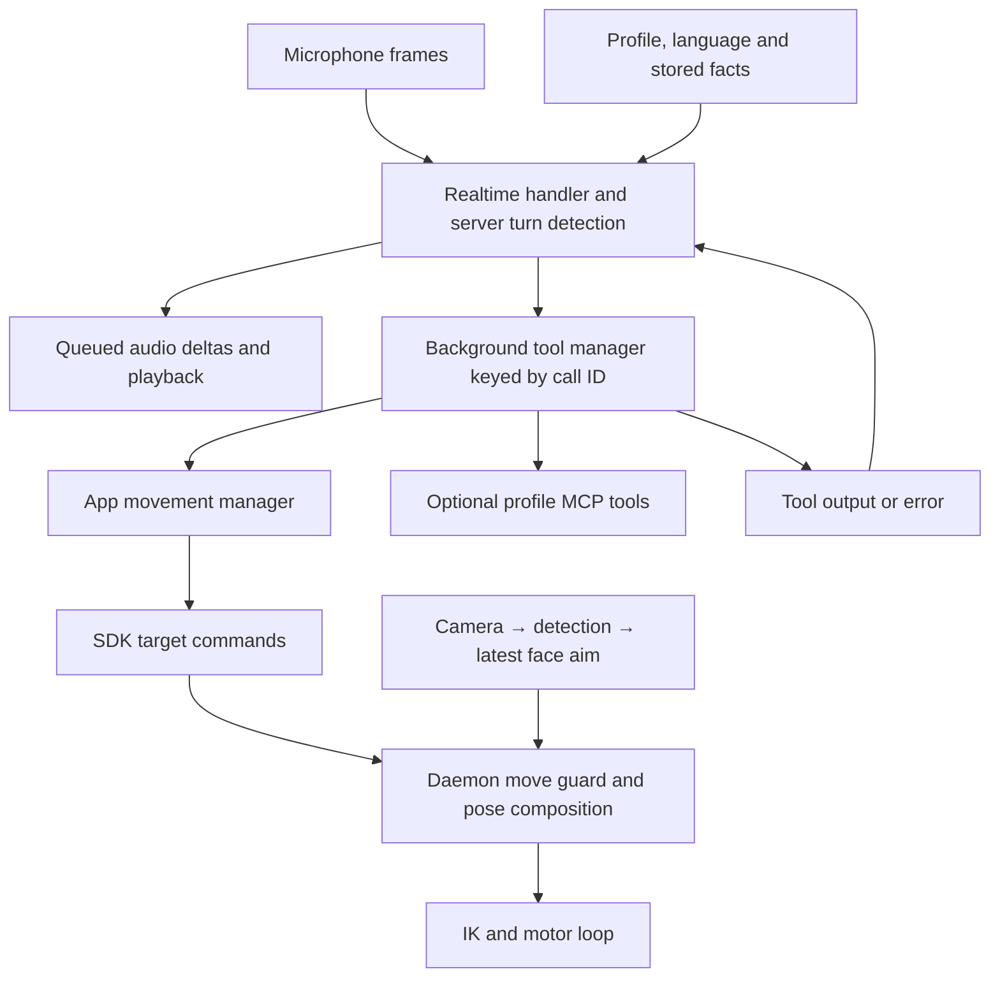
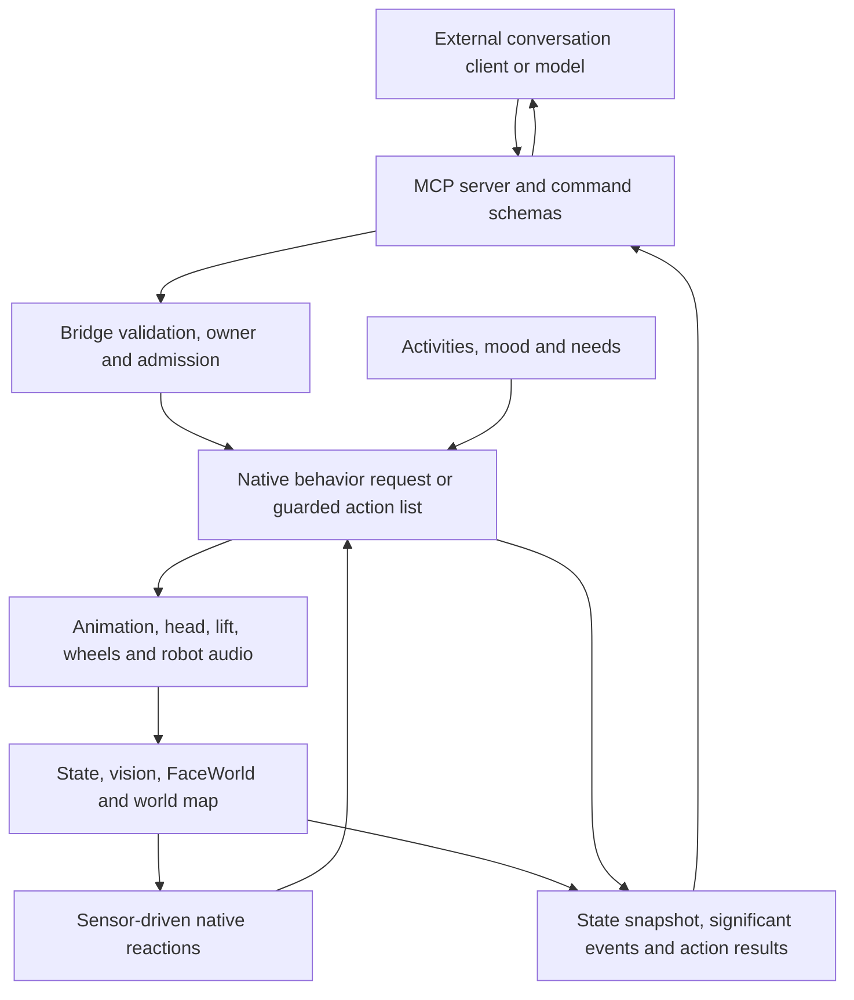

# Reachy Mini and Cozmo at the point of physical action

**Research snapshot · 28 November 2026.** The systems put the AI boundary in different places. Reachy's conversation app owns an audio session and can respond to an interruption before a model has finished speaking. Cozmo presents a physical robot to an external client through MCP. Its own engine already knows how to choose an activity, interrupt it for a reaction, express a need, track an object and report an action result. The best transfer is the conversation lifecycle. The most valuable capability to preserve is native ownership of behavior. [Individual findings](findings.md) · [Future architecture](proposed-cozmo-architecture.md)

## Reproducible scope

| Source tree | Examined revision | Role |
|---|---|---|
| [Reachy Mini](https://github.com/pollen-robotics/reachy_mini/tree/a4e5fcac1ef000889386309bd4e23693f9366ba5) | `a4e5fcac1ef000889386309bd4e23693f9366ba5` | SDK, daemon, hardware backend, motion and perception |
| [Reachy Mini conversation app](https://github.com/pollen-robotics/reachy_mini_conversation_app/tree/622a3a67582a1eb45c82b51251fa9f61a999b51d) | `622a3a67582a1eb45c82b51251fa9f61a999b51d` | Audio session, provider, tools, idle policy, memory and motion client |
| [Cozmo stack](https://github.com/jimbuschman/cozmo-stack/tree/1bd44f259ee4d4c75ee6182c75a25920669e4d86) | `1bd44f259ee4d4c75ee6182c75a25920669e4d86` | GitHub snapshot used for code and queue comparisons |
| Local Cozmo main | `50495d5bded1192048f58aac2f9ac20e3e5b2e15` | Earlier checkout used read-only to find session evidence |
| Local robot evidence | `0b5fb9927d1b092566721e1b4c6ba9fa4585f874` | Build identified by the November 26 session bundle. Predates the current nine-switch C2 configuration |

The three source clones are in the research workspace's `work/` directory, siblings of `outputs/`. The conversation app specifies a **minimum** SDK version. The two upstream heads are independently pinned source references, and this research did not establish that they were deployed together. A later Git LFS status operation on the app encountered a local filter error. The reviewed Python files were readable. Downloaded models, motion assets, hosted inference internals and any external MCP client are outside the runtime verification. [pyproject.toml L24–35](https://github.com/pollen-robotics/reachy_mini_conversation_app/blob/622a3a67582a1eb45c82b51251fa9f61a999b51d/pyproject.toml#L24-L35)

## Reachy Mini execution flow

1. **A user speaks.** The handler converts input frames to mono PCM, sends them to the session, and tracks local and server speech detection. Session instructions and available tools go with the session configuration. Local detection can duck playback. Server speech-start confirms an interruption and flushes pending audio. The handler discards obsolete response audio and cancels associated gestures. First provider audio and the end of physical playback are separate observations. [huggingface_realtime.py L479–502](https://github.com/pollen-robotics/reachy_mini_conversation_app/blob/622a3a67582a1eb45c82b51251fa9f61a999b51d/src/reachy_mini_conversation_app/huggingface_realtime.py#L479-L502) · [huggingface_realtime.py L1275–1346](https://github.com/pollen-robotics/reachy_mini_conversation_app/blob/622a3a67582a1eb45c82b51251fa9f61a999b51d/src/reachy_mini_conversation_app/huggingface_realtime.py#L1275-L1346) · [huggingface_realtime.py L389–422](https://github.com/pollen-robotics/reachy_mini_conversation_app/blob/622a3a67582a1eb45c82b51251fa9f61a999b51d/src/reachy_mini_conversation_app/huggingface_realtime.py#L389-L422) · [huggingface_realtime.py L1030–1080](https://github.com/pollen-robotics/reachy_mini_conversation_app/blob/622a3a67582a1eb45c82b51251fa9f61a999b51d/src/reachy_mini_conversation_app/huggingface_realtime.py#L1030-L1080)
2. **The model chooses a tool.** A completed argument event starts background work under its call ID. The manager retains task state and sends completion notifications. The handler returns a function result or error, sends any camera image separately, and requests a follow-up response after outstanding parallel calls settle. A closed session can lose the result. The default tool timeout is one day with periodic cleanup, unsuitable as a mobile robot's physical watchdog. [huggingface_realtime.py L1178–1228](https://github.com/pollen-robotics/reachy_mini_conversation_app/blob/622a3a67582a1eb45c82b51251fa9f61a999b51d/src/reachy_mini_conversation_app/huggingface_realtime.py#L1178-L1228) · [background_tool_manager.py L101–193](https://github.com/pollen-robotics/reachy_mini_conversation_app/blob/622a3a67582a1eb45c82b51251fa9f61a999b51d/src/reachy_mini_conversation_app/tools/background_tool_manager.py#L101-L193) · [background_tool_manager.py L255–278](https://github.com/pollen-robotics/reachy_mini_conversation_app/blob/622a3a67582a1eb45c82b51251fa9f61a999b51d/src/reachy_mini_conversation_app/tools/background_tool_manager.py#L255-L278) · [huggingface_realtime.py L849–975](https://github.com/pollen-robotics/reachy_mini_conversation_app/blob/622a3a67582a1eb45c82b51251fa9f61a999b51d/src/reachy_mini_conversation_app/huggingface_realtime.py#L849-L975)
3. **The app moves the robot.** For app-managed moves, the movement thread evaluates the queued primary move and sends targets on its own cadence. Separately, clients may request a daemon-managed trajectory. The daemon serializes those trajectories, reports a competing move as busy, and can acknowledge direct target updates it ignores during an active move. Success at the API boundary is therefore specific to the command. [moves.py L482–536](https://github.com/pollen-robotics/reachy_mini_conversation_app/blob/622a3a67582a1eb45c82b51251fa9f61a999b51d/src/reachy_mini_conversation_app/moves.py#L482-L536) · [moves.py L810–839](https://github.com/pollen-robotics/reachy_mini_conversation_app/blob/622a3a67582a1eb45c82b51251fa9f61a999b51d/src/reachy_mini_conversation_app/moves.py#L810-L839) · [abstract.py L482–513](https://github.com/pollen-robotics/reachy_mini/blob/a4e5fcac1ef000889386309bd4e23693f9366ba5/src/reachy_mini/daemon/backend/abstract.py#L482-L513) · [abstract.py L1737–1775](https://github.com/pollen-robotics/reachy_mini/blob/a4e5fcac1ef000889386309bd4e23693f9366ba5/src/reachy_mini/daemon/backend/abstract.py#L1737-L1775)
4. **The head follows a face.** A low-priority worker takes recent frames, downsizes to a 320-pixel detection pipeline and publishes timestamped geometric observations. The daemon blends a weighted aim with base pose and speech offsets before inverse kinematics. The conversation app can reduce tracking weight to zero during speech **if it has already acquired a face**, preserving an anchor, then restore it afterward. New acquisition remains possible if speaking began without a lock. These are different decisions at the application and daemon layers. [face_tracking.py L96–136](https://github.com/pollen-robotics/reachy_mini/blob/a4e5fcac1ef000889386309bd4e23693f9366ba5/src/reachy_mini/vision/face_tracking.py#L96-L136) · [face_tracking.py L248–288](https://github.com/pollen-robotics/reachy_mini/blob/a4e5fcac1ef000889386309bd4e23693f9366ba5/src/reachy_mini/vision/face_tracking.py#L248-L288) · [abstract.py L602–635](https://github.com/pollen-robotics/reachy_mini/blob/a4e5fcac1ef000889386309bd4e23693f9366ba5/src/reachy_mini/daemon/backend/abstract.py#L602-L635) · [moves.py L441–472](https://github.com/pollen-robotics/reachy_mini_conversation_app/blob/622a3a67582a1eb45c82b51251fa9f61a999b51d/src/reachy_mini_conversation_app/moves.py#L441-L472)

## Cozmo execution flow

1. **Tool discovery and dispatch.** The MCP server exports command schemas from the same bridge catalogue it dispatches, plus read-only state/map/image/event tools. It processes outstanding request IDs concurrently, serializes output and accepts request cancellation. The contract distinguishes submission, owned completion and native failure. Most ordinary commands need a client turn; significant events can also be pushed through the optional Claude channel. A generic client can consume cursor-based pages. [CozmoMcpServer.cs L20–53](https://github.com/jimbuschman/cozmo-stack/blob/1bd44f259ee4d4c75ee6182c75a25920669e4d86/cozmo-stack/src/Cozmo.Mcp/CozmoMcpServer.cs#L20-L53) · [CozmoMcpServer.cs L87–139](https://github.com/jimbuschman/cozmo-stack/blob/1bd44f259ee4d4c75ee6182c75a25920669e4d86/cozmo-stack/src/Cozmo.Mcp/CozmoMcpServer.cs#L87-L139) · [CozmoMcpServer.cs L194–224](https://github.com/jimbuschman/cozmo-stack/blob/1bd44f259ee4d4c75ee6182c75a25920669e4d86/cozmo-stack/src/Cozmo.Mcp/CozmoMcpServer.cs#L194-L224) · [CozmoMcpServer.cs L404–433](https://github.com/jimbuschman/cozmo-stack/blob/1bd44f259ee4d4c75ee6182c75a25920669e4d86/cozmo-stack/src/Cozmo.Mcp/CozmoMcpServer.cs#L404-L433) · [CozmoBridge.Commands.cs L9–24](https://github.com/jimbuschman/cozmo-stack/blob/1bd44f259ee4d4c75ee6182c75a25920669e4d86/cozmo-stack/src/Cozmo.Bridge/CozmoBridge.Commands.cs#L9-L24)
2. **Request a behavior or track someone.** A behavior request enters the engine owner, passes availability and type checks, then calls the retained runtime's request path. The chooser and reactions still control execution. A face-tracking request instead returns a native action tag on admission. Only the owning caller can cancel an active tag. A model that reads “submitted” as “following” will misreport both cases. A head-only command can still conflict with an authored head animation. [CozmoBridge.ActionResults.cs L9–48](https://github.com/jimbuschman/cozmo-stack/blob/1bd44f259ee4d4c75ee6182c75a25920669e4d86/cozmo-stack/src/Cozmo.Bridge/CozmoBridge.ActionResults.cs#L9-L48) · [CozmoBridge.ActionResults.cs L101–116](https://github.com/jimbuschman/cozmo-stack/blob/1bd44f259ee4d4c75ee6182c75a25920669e4d86/cozmo-stack/src/Cozmo.Bridge/CozmoBridge.ActionResults.cs#L101-L116) · [BehaviorManager.cs L1011–1040](https://github.com/jimbuschman/cozmo-stack/blob/1bd44f259ee4d4c75ee6182c75a25920669e4d86/cozmo-stack/src/Cozmo.Robot/Behavior/BehaviorManager.cs#L1011-L1040) · [NativeTrackFaceRunner.cs L250–260](https://github.com/jimbuschman/cozmo-stack/blob/1bd44f259ee4d4c75ee6182c75a25920669e4d86/cozmo-stack/src/Cozmo.Robot/Vision/NativeTrackFaceRunner.cs#L250-L260)
3. **Say a sentence.** The bridge's English `say-text` command enters the existing robot speech path. It checks Windows, resources and English sound banks or active runtime audio, current robot owner, connection and readiness. It allocates a tagged action, opens the external-command Freeplay bracket, and admits against the action list. Cancellation posts back to the engine, targets the original owner, and waits for its completion path. The voice provider synthesizes through Acapela. A local microphone, speech recognizer and turn-end detector are separate concerns. [CozmoBridge.Commands.cs L74–79](https://github.com/jimbuschman/cozmo-stack/blob/1bd44f259ee4d4c75ee6182c75a25920669e4d86/cozmo-stack/src/Cozmo.Bridge/CozmoBridge.Commands.cs#L74-L79) · [SpeechOwner.cs L167–191](https://github.com/jimbuschman/cozmo-stack/blob/1bd44f259ee4d4c75ee6182c75a25920669e4d86/cozmo-stack/src/Cozmo.Robot/SpeechOwner.cs#L167-L191) · [SpeechOwner.cs L212–288](https://github.com/jimbuschman/cozmo-stack/blob/1bd44f259ee4d4c75ee6182c75a25920669e4d86/cozmo-stack/src/Cozmo.Robot/SpeechOwner.cs#L212-L288) · [SpeechProvider.cs L14–61](https://github.com/jimbuschman/cozmo-stack/blob/1bd44f259ee4d4c75ee6182c75a25920669e4d86/cozmo-stack/src/Cozmo.Robot/Animation/SpeechProvider.cs#L14-L61)
4. **Observe what happened.** The state snapshot includes current activity, behavior, reaction, requested Freeplay, owned actions, known entities and needs. The event feed distinguishes repeated sightings, significant recognitions, charger transitions and completions. The image endpoint can select a frame that has corresponding perception results and report which newer image was received. A current album name, a detection from an earlier frame, and a fresh face pose have different meanings. [CozmoBridge.cs L111–130](https://github.com/jimbuschman/cozmo-stack/blob/1bd44f259ee4d4c75ee6182c75a25920669e4d86/cozmo-stack/src/Cozmo.Bridge/CozmoBridge.cs#L111-L130) · [CozmoBridge.cs L158–189](https://github.com/jimbuschman/cozmo-stack/blob/1bd44f259ee4d4c75ee6182c75a25920669e4d86/cozmo-stack/src/Cozmo.Bridge/CozmoBridge.cs#L158-L189) · [CozmoBridge.SignificantEvents.cs L15–65](https://github.com/jimbuschman/cozmo-stack/blob/1bd44f259ee4d4c75ee6182c75a25920669e4d86/cozmo-stack/src/Cozmo.Bridge/CozmoBridge.SignificantEvents.cs#L15-L65) · [CozmoBridge.Senses.cs L134–180](https://github.com/jimbuschman/cozmo-stack/blob/1bd44f259ee4d4c75ee6182c75a25920669e4d86/cozmo-stack/src/Cozmo.Bridge/CozmoBridge.Senses.cs#L134-L180)
5. **Return to native life.** The behavior manager evaluates reactions before ordinary selection. Reaction completion can try a native resume target. Socialize, PlayAlone and other activities have their own eligibility and priorities. Host command-bracket disposal and native behavior resumption are different events. The user-visible outcome is whether appropriate Freeplay actually returns. [BehaviorManager.cs L640–750](https://github.com/jimbuschman/cozmo-stack/blob/1bd44f259ee4d4c75ee6182c75a25920669e4d86/cozmo-stack/src/Cozmo.Robot/Behavior/BehaviorManager.cs#L640-L750) · [BehaviorManager.cs L1292–1403](https://github.com/jimbuschman/cozmo-stack/blob/1bd44f259ee4d4c75ee6182c75a25920669e4d86/cozmo-stack/src/Cozmo.Robot/Behavior/BehaviorManager.cs#L1292-L1403) · [FreeplaySystem.cs L156–193](https://github.com/jimbuschman/cozmo-stack/blob/1bd44f259ee4d4c75ee6182c75a25920669e4d86/cozmo-stack/src/Cozmo.Robot/Behavior/FreeplaySystem.cs#L156-L193) · [SpeechOwner.cs L269–288](https://github.com/jimbuschman/cozmo-stack/blob/1bd44f259ee4d4c75ee6182c75a25920669e4d86/cozmo-stack/src/Cozmo.Robot/SpeechOwner.cs#L269-L288)

## What the historical robot runs establish

| Question | Older observation | What resolves or limits it |
|---|---|---|
| Does saying text during Freeplay work? | A previous conflict motivated a speech retest. | Session 7 records InteractWithFaces yielding, Wait, then SayTextAnimation. The local `20261126-094739-LLM-SESSION/events.jsonl` lines 4853 and 5028 independently show the SayText preconditions and native SUCCESS. Neither signal measures audible start or proves every resume case. [20261126-llm-session-7-notes.md L8–21](https://github.com/jimbuschman/cozmo-stack/blob/1bd44f259ee4d4c75ee6182c75a25920669e4d86/re-analysis/research/20261126-llm-session-7-notes.md#L8-L21) |
| Does a face turn mean the person saw Cozmo turn? | A request reported success while the observer saw no turn. | Current command documentation explicitly permits SUCCESS without a current face pose. The selected/not-runnable event now exists too. The remaining issue is interpreting the available evidence across a turn. [20261126-llm-session-7-notes.md L28–47](https://github.com/jimbuschman/cozmo-stack/blob/1bd44f259ee4d4c75ee6182c75a25920669e4d86/re-analysis/research/20261126-llm-session-7-notes.md#L28-L47) · [CozmoBridge.Commands.cs L60–65](https://github.com/jimbuschman/cozmo-stack/blob/1bd44f259ee4d4c75ee6182c75a25920669e4d86/cozmo-stack/src/Cozmo.Bridge/CozmoBridge.Commands.cs#L60-L65) · [CozmoBridge.Commands.cs L129–135](https://github.com/jimbuschman/cozmo-stack/blob/1bd44f259ee4d4c75ee6182c75a25920669e4d86/cozmo-stack/src/Cozmo.Bridge/CozmoBridge.Commands.cs#L129-L135) |
| Does disabling Freeplay stop vision? | Session 3 initially suggested it did. | The author corrected that interpretation after comparing processed and received frames. A narrower marker-sighting gap remained with confounding movement and visibility. [20261120-llm-session-3-notes.md L183–188](https://github.com/jimbuschman/cozmo-stack/blob/1bd44f259ee4d4c75ee6182c75a25920669e4d86/re-analysis/research/20261120-llm-session-3-notes.md#L183-L188) · [20261120-llm-session-3-notes.md L225–232](https://github.com/jimbuschman/cozmo-stack/blob/1bd44f259ee4d4c75ee6182c75a25920669e4d86/re-analysis/research/20261120-llm-session-3-notes.md#L225-L232) · [20261120-llm-session-3-notes.md L278–295](https://github.com/jimbuschman/cozmo-stack/blob/1bd44f259ee4d4c75ee6182c75a25920669e4d86/re-analysis/research/20261120-llm-session-3-notes.md#L278-L295) |
| Is cliff avoidance validated by a response event? | The operator caught the robot after a cliff stop during play. | In local `20261126-095506-LLM-SESSION/stack-log.txt` lines 5640, 5693, 5700 and 6584 corroborate the firmware stop, the reaction animation, an undetected event and a later Wi-Fi timeout. They cannot isolate the cause of the fall. The later switchable body hold has offline regression evidence. [20261126-llm-session-7-notes.md L66–92](https://github.com/jimbuschman/cozmo-stack/blob/1bd44f259ee4d4c75ee6182c75a25920669e4d86/re-analysis/research/20261126-llm-session-7-notes.md#L66-L92) · [SCOPE.md L73–80](https://github.com/jimbuschman/cozmo-stack/blob/1bd44f259ee4d4c75ee6182c75a25920669e4d86/re-analysis/SCOPE.md#L73-L80) |
| Does “A 16/16, B 40/40” mean every physical goal succeeded? | Earlier rows in the living scope document report several failures or pending runs. | The November 26 count includes failures that matched the original under the operator's stop rule. Session 5 already reported teach/rename/erase passed. Use the dated rollup for acceptance and retain the individual observations for feasibility. [SCOPE.md L112–138](https://github.com/jimbuschman/cozmo-stack/blob/1bd44f259ee4d4c75ee6182c75a25920669e4d86/re-analysis/SCOPE.md#L112-L138) |

The historical private logs above were spot-read in the local checkout under `re-analysis/acceptance/hardware/`. They were not republished. Neither robot was operated for this study. No private binary disassembly was repeated, no comparative timing measurements were taken, and no implementation checkout, branch or queue was changed by the research.
