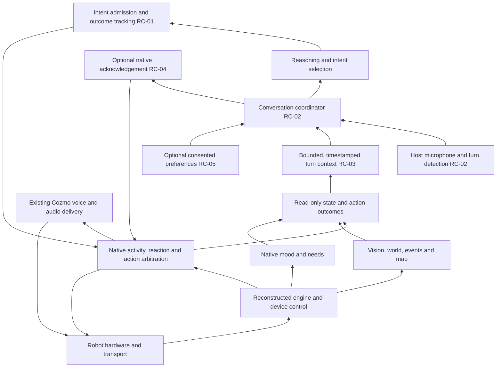
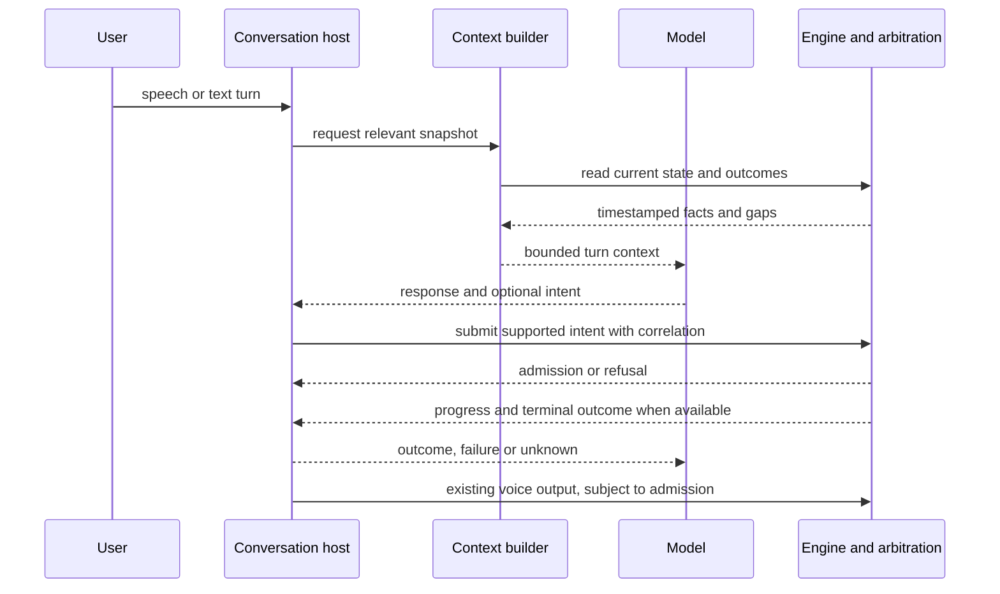

# Proposed Cozmo architecture

This design is a hypothesis for staged evaluation against observed robot behavior. It retains the engine as the owner of physical behavior and places higher-level conversation and reasoning above its existing command and event interfaces. The five candidates below are proposals for future approval, not implemented capabilities or queue items. Evidence and historical hardware limits are detailed in [findings](findings.md) and [architecture comparison](architecture-comparison.md).

The inspected Cozmo snapshot is `1bd44f259ee4d4c75ee6182c75a25920669e4d86`. Links identify source at that revision. Source alone establishes code paths, not timing, full fidelity, or successful physical behavior.

## Ownership and existing components

| Layer | Existing evidence | Proposed responsibility and boundary |
| --- | --- | --- |
| Hardware and transport | The stack already controls the robot and receives state. | Own connectivity and device facts. Report disconnect and firmware stop promptly to the engine and host. |
| Original engine and device control | The reconstructed engine targets observable behavior, with visible gaps and defined departures. | Own state, device control, timing and safety reactions. A host request is an input to this layer, never an instruction to bypass it. |
| Behavior arbitration | `BehaviorManager.Update` checks reactions before ordinary selection and keeps current and resumable behavior. [Manager source](https://github.com/jimbuschman/cozmo-stack/blob/1bd44f259ee4d4c75ee6182c75a25920669e4d86/cozmo-stack/src/Cozmo.Robot/Behavior/BehaviorManager.cs#L1000) | Own admission, native track ownership, reactions, interruption and resumption. Expose an outcome for each request. Preserve the native policy when a requested action is unavailable. |
| Perception and environmental state | Existing vision modes, face world, object observations and memory map provide substantial state. [Vision](https://github.com/jimbuschman/cozmo-stack/blob/1bd44f259ee4d4c75ee6182c75a25920669e4d86/cozmo-stack/src/Cozmo.Robot/Vision/VisionSystem.cs#L940), [map](https://github.com/jimbuschman/cozmo-stack/blob/1bd44f259ee4d4c75ee6182c75a25920669e4d86/cozmo-stack/src/Cozmo.Robot/Vision/MemoryMap.cs#L7) | Own observations, timestamps, identity, localization and confidence. The host can summarize events, but cannot turn a stale sighting into a commandable target. |
| Emotion and motivation | Existing mood events, decay and needs influence behavior. [Mood](https://github.com/jimbuschman/cozmo-stack/blob/1bd44f259ee4d4c75ee6182c75a25920669e4d86/cozmo-stack/src/Cozmo.Robot/Behavior/Mood.cs#L302), [needs](https://github.com/jimbuschman/cozmo-stack/blob/1bd44f259ee4d4c75ee6182c75a25920669e4d86/cozmo-stack/src/Cozmo.Robot/Behavior/Needs.cs#L369) | Native systems own emotion and needs. Context may describe available values and uncertainty. Any influence on native state requires an existing supported engine input or a separately approved extension. |
| AI intent and outcomes | External command and event surfaces already exist, with native admission and physical validation varying by operation. | RC-01 correlates intent, admission and terminal outcomes using existing APIs where possible. It translates semantic requests into supported operations, reports refusal, and never asserts success on submission alone. |
| Conversation | Existing Cozmo voice output has been heard on hardware. Faster synthesis has an offline measurement, with robot validation pending. [Scope and status](https://github.com/jimbuschman/cozmo-stack/blob/1bd44f259ee4d4c75ee6182c75a25920669e4d86/re-analysis/SCOPE.md#L15) | RC-02 owns host microphone input, turn boundaries, interrupt handling and orchestration of existing speech. Playback state must reflect actual output callbacks or an explicit unknown. |
| Cognitive reasoning and planning | An external LLM bridge exists. The evidence does not establish a persistent autonomous planner within the engine. | Select and explain high-level goals within available capabilities. Decompose complex requests conservatively, checking each outcome and current context before the next step. |
| Memory and personality | Native needs, mood, face enrollment and freeplay already contribute state and character. | RC-05 optionally stores consented user preferences as external facts with provenance, review and deletion. Do not duplicate native mood or assert that preference storage is learned personality development. |

## Decisions and coordination

The engine decides whether a requested movement is physically admissible, which native reaction takes precedence, which tracks are owned, whether a behavior can resume, and what action result occurred. It owns localization and safety state. The LLM chooses conversational content and may propose a goal or a supported action using a bounded context. It should express uncertainty and defer when relevant state or result is unavailable. The host coordinates the conversation, checks freshness, submits eligible intent, and conveys native acceptance and completion to the model. It does not impersonate an engine outcome.

An intent should identify an operation, parameters, target identity and observation timestamp when relevant, conversation turn, request ID, and an expiry or deadline where supported. The response should distinguish submitted, admitted or waiting, rejected, running, completed, cancelled, failed and unknown. These are proposed host-level states. The adapter must map actual native responses honestly, including unknown when an API cannot establish a state. A timeout in the host does not establish physical cancellation. Reconciliation must check the native operation before any retry, especially after a disconnect.

The LLM can influence freeplay by selecting existing exposed activities or requesting supported actions through the current admission path. It should not write a behavior pointer, manipulate track locks directly, suppress safety reactions, or infer that interruption implies successful completion. The engine's manager checks reaction strategies on each update and gates ordinary selection, and it has explicit resume handling. [Reaction and chooser](https://github.com/jimbuschman/cozmo-stack/blob/1bd44f259ee4d4c75ee6182c75a25920669e4d86/cozmo-stack/src/Cozmo.Robot/Behavior/BehaviorManager.cs#L1011), [resume](https://github.com/jimbuschman/cozmo-stack/blob/1bd44f259ee4d4c75ee6182c75a25920669e4d86/cozmo-stack/src/Cozmo.Robot/Behavior/BehaviorManager.cs#L1292)

## When to think and what to send

Inference is appropriate for an explicit user turn, an ambiguous social interaction, or a genuinely new event that needs interpretation beyond native reactions. A future proactive trigger should be opt-in, rate-limited, deduplicated and suppressed during critical physical activity. A native event remains actionable by the engine even if inference is slow or disabled. Simple idle animation, exploration and reactive behavior can continue through existing freeplay without a model call.

RC-03 should construct a small turn-specific snapshot containing the user's current utterance, recent relevant conversation, current activity and reaction, active request IDs and their last known outcomes, current connection and safety state, and relevant observed faces or objects with age and identity. Include native mood or needs only when already exposed and relevant. Include localization or map confidence when a spatial goal is requested. Mark absent, stale and unknown data explicitly. Retrieve a consented preference only if relevant. Coalesce repeated sightings and impose both age and size limits. Fresh sensor observations should replace stale summaries, and result events should be retained until the conversation has acknowledged them.

An ongoing activity should be represented by its native identifier, start time, resource or track information where available, admission state, last result and interruption status. It must not be labeled resumable solely because it was interrupted. Test the existing resume path and publish unknown where the API cannot prove restoration.

## Turn and action flows

For user interruption, the host first stops or cancels the current conversation response using supported audio controls, marks its turn as interrupted, and handles the new input. It separately requests cancellation of any physical action only when the user intent and native API justify it. It waits for or reconciles the native result before reporting the action stopped. A speech interruption must not automatically override a cliff reaction or assume that a motor command has stopped.

For conflicting requests, preserve native safety and reaction priority. Serialize conflicting host intents, let the native admission path decide compatibility, and communicate busy or rejection with the current activity when available. Coexistence of speech, tracking and movement requires track-specific verification. The face tracker explicitly locks owned tracks and can be head-only, but that alone does not establish universal overlap with speech or animation. [Tracker](https://github.com/jimbuschman/cozmo-stack/blob/1bd44f259ee4d4c75ee6182c75a25920669e4d86/cozmo-stack/src/Cozmo.Robot/Vision/NativeTrackFaceRunner.cs#L37), [track ownership](https://github.com/jimbuschman/cozmo-stack/blob/1bd44f259ee4d4c75ee6182c75a25920669e4d86/cozmo-stack/src/Cozmo.Robot/Vision/NativeTrackFaceRunner.cs#L250)

RC-04 can request a short authored listening or waiting acknowledgement through native arbitration, only when appropriate and available. Suppress it during conflicting motion or safety reactions, avoid repeated loops, and stop it through its normal lifecycle. Physical tests should determine whether the result improves responsiveness without delaying speech or tracking.

## Failure handling and recovery

- **Model unavailable or slow.** Expire the pending turn cleanly, preserve native freeplay and reactions, and communicate an unavailable or delayed response through a supported channel. Bound concurrent inference and discard responses for superseded turns.
- **Speech or microphone failure.** Keep physical control available. Expose the failed stage and avoid claiming a response was heard. Validate interruption with actual playback state.
- **Action refusal or failure.** Return the actual reason or an explicit unknown. Avoid automatic repetition of physical motion. Obtain fresh state and ask for new intent when the outcome is ambiguous.
- **Disconnect or timeout.** Invalidate stale handles and in-flight assumptions, cancel host waits, reconnect through existing lifecycle, and reconcile current state before another request. A local timeout is not evidence that the robot stopped.
- **Stale perception or uncertain localization.** Withhold spatial action or request a fresh observation through a supported behavior. Do not promote a remembered landmark into a currently commandable pose without its anchoring and freshness checks.
- **Memory unavailable.** Continue without preference recall and report an error to the host. Memory should never gate native activity or basic conversation.

## Baseline and evaluation gates

The library's `CozmoC2Settings.Baseline` disables the named C2 switches, whereas the MCP executable uses `McpDefaults` unless `--baseline` is supplied. [Settings](https://github.com/jimbuschman/cozmo-stack/blob/1bd44f259ee4d4c75ee6182c75a25920669e4d86/cozmo-stack/src/Cozmo.Robot/CozmoC2Settings.cs#L7) If a candidate changes robot behavior beyond the reconstructed engine, implement it only as an explicitly named, logged, switchable extension under existing conventions, with baseline regression tests. Host-only conversation components should also have independent enablement and should not change engine defaults. Current project scope places C2 implementation after required A and B work. [Scope](https://github.com/jimbuschman/cozmo-stack/blob/1bd44f259ee4d4c75ee6182c75a25920669e4d86/re-analysis/SCOPE.md#L71)

Evaluate first in deterministic tests with fake delayed, duplicated, failed and out-of-order events, then integration tests against the existing bridge and finally operator-supervised physical trials. Measure speech first-audio latency, interruption time, outcome accuracy, native reaction delay, freeplay restoration, and conflicting-track behavior. Include LLM-off and baseline runs. Physical observations should distinguish engine success, operator-observed behavior and unresolved gaps. The historical report of 9–17 second speech latency predates the approximately three-second offline result, which still requires robot validation. [Session notes](https://github.com/jimbuschman/cozmo-stack/blob/1bd44f259ee4d4c75ee6182c75a25920669e4d86/re-analysis/research/20261120-llm-session-3-notes.md#L20), [scope](https://github.com/jimbuschman/cozmo-stack/blob/1bd44f259ee4d4c75ee6182c75a25920669e4d86/re-analysis/SCOPE.md#L20)

**What the host can read today.** GetState projects needs and the active behavior/reaction, but the inspected projection does not publish a full emotional vector. FreeplaySystem documents the engine's separate timed mood update and nine-float broadcast. RC-03 can start with needs alone. If mood adds measurable value, expose a read-only sample with its source time under the approved extension convention. A guessed mood derived by the model would defeat this purpose. [CozmoBridge.cs L172–189](https://github.com/jimbuschman/cozmo-stack/blob/1bd44f259ee4d4c75ee6182c75a25920669e4d86/cozmo-stack/src/Cozmo.Bridge/CozmoBridge.cs#L172-L189) · [FreeplaySystem.cs L174–192](https://github.com/jimbuschman/cozmo-stack/blob/1bd44f259ee4d4c75ee6182c75a25920669e4d86/cozmo-stack/src/Cozmo.Robot/Behavior/FreeplaySystem.cs#L174-L192)

**Optional cognitive service.** Begin with the external client already selecting the model and a local bounded store for preferences. BlipShell could later consume the same read-only turn facts and return a suggested goal with an expiry. Compare it with the simpler host on recall accuracy, ambiguous identity, latency and behavior during an outage. The engine would only receive a newly admitted native intent. This review did not establish an existing or required BlipShell integration.
